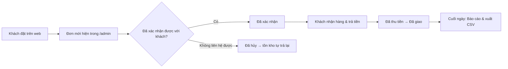

# Hướng dẫn vận hành hội chợ

Dành cho ban tổ chức và giáo viên trực gian hàng. Không cần biết lập trình.

---

## 1. Đăng nhập

1. Mở `https://<tên-miền>/admin` (trên máy tính hoặc điện thoại).
2. Nhập email + mật khẩu ban tổ chức → **Đăng nhập**.
3. Góc phải trên cùng có tên người dùng và nút **Đăng xuất**. Hãy đăng xuất khi rời máy tính dùng chung.

> Quên mật khẩu: liên hệ người quản trị Supabase (mục Authentication → Users → Reset password).

---

## 2. Quy trình một ngày hội chợ

### Buổi sáng – trước khi mở cửa

- [ ] Vào **Đơn hàng**: xử lý hết đơn của hôm trước.
- [ ] Vào **Sản phẩm**: kiểm tra cột **Tồn** – mặt hàng nào về 0 thì đổi trạng thái **Hết hàng**.
- [ ] Vào **Cấu hình**: xác nhận **Giờ nhận hàng** và **Địa chỉ điểm nhận** đúng với ngày hôm nay.
- [ ] Kiểm tra số tài khoản nhận chuyển khoản hiện đúng (badge phải ghi “Đã cấu hình”).

### Trong ngày

- Chuông 🔔 ở góc phải báo số **đơn mới**. Bấm vào để xem nhanh mã đơn, tên khách, số tiền.
- Vào tab **Đơn hàng** để xử lý.

### Cuối ngày

1. Tab **Báo cáo** → xem *Doanh thu thực tế*, *Đã thu tiền*, *Hoàn thành dự toán*.
2. Bấm **Xuất CSV** để lưu báo cáo, hoặc **In PDF** để nộp.
3. Đối chiếu tiền mặt + chuyển khoản với “Đã thu tiền”.

---

## 3. Tab Đơn hàng

Mỗi đơn hiển thị: mã `HSXM-XXXXXX`, khách, SĐT, lớp/đơn vị, sản phẩm, tổng tiền, hình thức thanh toán.

**Năm trạng thái – bấm nút tương ứng để chuyển:**

| Trạng thái | Ý nghĩa | Khi nào chuyển |
| --- | --- | --- |
| **Mới** | Khách vừa đặt | Mặc định |
| **Đã xác nhận** | Đã gọi/ nhắn xác nhận với khách | Sau khi liên hệ được |
| **Đã thu tiền** | Đã nhận tiền (mặt hoặc CK) | Khi thu tiền xong |
| **Đã giao** | Khách đã nhận hàng | Khi trao hàng |
| **Đã hủy** | Đơn bị hủy | Khi khách báo hủy / không liên hệ được |

### Điều quan trọng cần biết về **Đã hủy**

- Hủy đơn → số lượng **tự động trả lại** vào tồn kho, khách khác đặt được ngay.
- Mở lại đơn đã hủy → hệ thống kiểm tra tồn; nếu không đủ hàng sẽ báo lỗi và **không** mở.
- Vì vậy đừng hủy đơn chỉ để “dọn danh sách” – hãy dùng khi thật sự hủy.

### Tìm đơn nhanh

Dùng ô tìm kiếm để lọc theo mã đơn, tên khách hoặc số điện thoại. Khách gọi đến chỉ cần đọc SĐT là ra đơn.

---

## 4. Tab Sản phẩm

Bảng gồm: tên, nhóm/nguồn, giá bán, tồn, trạng thái, thao tác.

### Đổi trạng thái

| Trạng thái | Hiển thị với khách | Dùng khi |
| --- | --- | --- |
| **Đang bán** | Có, đặt được | Bình thường |
| **Hết hàng** | Có, không đặt được | Tạm hết nhưng vẫn giới thiệu |
| **Chờ xác nhận nguồn cung HTX** | Có, **đặt trước được** | Khách yêu cầu món chưa nhập |
| **Chờ duyệt** | Không hiện | Lớp/HTX vừa gửi, chưa kiểm tra |
| **Đã ẩn** | Không hiện | Gỡ khỏi gian hàng nhưng giữ dữ liệu |

> Ưu tiên **Đã ẩn** thay vì **Xóa**. Xóa là vĩnh viễn và làm mất dòng đó khỏi báo cáo.

### Sửa sản phẩm

Bấm **Sửa** để đổi: tên, giá chợ min/max, giá nhập, giá bán, tổng số lượng, đơn vị, trạng thái, mô tả dinh dưỡng,
quy trình an toàn, bảo quản, và **ảnh thật**.

- **Thay ảnh thật**: chọn ảnh từ máy/điện thoại. Ảnh tự nén về tối đa 1200px, tải lên kho ảnh Supabase.
  Nếu không có ảnh thật, hệ thống dùng ảnh minh họa vẽ sẵn theo nhóm sản phẩm (có nhãn “Ảnh minh họa”).
- **Không** đặt số lượng nhỏ hơn số đã có người đặt (ô “Đã đặt” khóa, tự cộng theo đơn).
- Khung vàng hiển thị biên lợi nhuận và cảnh báo nếu giá bán cao hơn giá chợ trung bình.

### Duyệt sản phẩm do lớp/HTX gửi

Sản phẩm nguồn **Lớp / HTX đăng** vào trạng thái **Chờ duyệt** (trừ khi bật tự động duyệt trong Cấu hình).
Quy trình duyệt:

1. Đọc kỹ tên, xuất xứ, quy cách, tiêu chuẩn an toàn, giá.
2. Đối chiếu giá với giá chợ thực tế.
3. Nếu ổn → **Duyệt** (chuyển sang Đang bán). Nếu chưa ổn → **Ẩn** và liên hệ người gửi.

---

## 5. Tab Yêu cầu & duyệt

Nơi tập trung hai loại:

- **Khách yêu cầu thêm sản phẩm** – hiện trạng thái *Chờ xác nhận nguồn cung HTX*. Có thể đặt trước.
  Ban tổ chức xác nhận với HTX rồi cập nhật giá/tồn và chuyển sang **Đang bán**.
- **Lớp/HTX tự đăng bán** – vào *Chờ duyệt*, xử lý như mục 4.

---

## 6. Tab Cấu hình

| Mục | Ảnh hưởng |
| --- | --- |
| **Chi phí vận chuyển & đóng gói** | Trừ vào lợi nhuận gộp để ra lợi nhuận ròng. Đổi số này → mọi báo cáo tự tính lại. Mặc định 1.716.000 đ. |
| **Địa chỉ điểm nhận** | Hiện ở trang chủ, trang vị trí, trang đặt hàng, trang đơn thành công. |
| **Giờ nhận hàng** | Như trên. Cập nhật theo từng ngày hội chợ. |
| **Hotline** | Hiện ở chân trang và trang liên hệ. |
| **Ngân hàng / số tài khoản / tên chủ TK** | Sinh mã VietQR theo đúng số tiền từng đơn. **Điền số thật trước hội chợ.** |
| **Mã mời lớp/HTX** | Chia sẻ riêng cho đại diện lớp. Đổi mã sẽ vô hiệu mã cũ ngay. |
| **Tự động duyệt** | Bật = sản phẩm lớp/HTX lên kệ ngay. Chỉ bật khi tin tưởng hoàn toàn. |
| **Link Google Maps** | Bản đồ ở trang Vị trí. Lấy bằng: Google Maps → Chia sẻ → Nhúng bản đồ → copy `src`. |
| **Địa chỉ website** | Dùng tạo mã QR chia sẻ. |

> Luôn bấm **Lưu cấu hình** sau khi sửa. Nút Lưu nằm cố định ở cuối trang.

### Nếu chưa có số tài khoản thật

Để nguyên placeholder. Khách chọn “Chuyển khoản” vẫn đặt được, nhưng trang đơn hàng sẽ nhắc thanh toán COD.
Cập nhật số thật trong Cấu hình là mã QR hiện đúng ngay, không cần build lại.

---

## 7. Tab Báo cáo

- **Doanh thu dự toán** – giá bán × số lượng dự kiến của toàn bộ sản phẩm đang tính.
- **Doanh thu thực tế** – tổng các đơn **không hủy**.
- **Đã thu tiền** – đơn ở trạng thái *Đã thu tiền* + *Đã giao*.
- **Hoàn thành dự toán** – thực tế / dự toán.
- **Top 5 bán chạy** – theo doanh thu thực tế.
- **Bảng thực tế so với dự toán** – từng sản phẩm, có thanh tỷ lệ lấp đầy.

Nút **Xuất CSV** mở được bằng Excel; **In PDF** để nộp báo cáo giấy.

### Ba con số tài chính cần nhớ

| Chỉ tiêu | Cách tính | Giá trị với 34 sản phẩm gốc |
| --- | --- | --- |
| Doanh thu dự toán | Σ(giá bán × SL) | 42.135.000 đ |
| Lợi nhuận gộp | doanh thu − Σ(giá nhập × SL) | 8.516.000 đ |
| Lợi nhuận ròng | gộp − chi phí VC & đóng gói | 6.800.000 đ |
| Tỷ suất ròng | ròng ÷ doanh thu | 16,14% |

> **Tỷ lệ tiết kiệm trung bình** hiển thị là **20,24%** – trung bình cộng tỷ lệ tiết kiệm của từng mặt hàng so với giá
> chợ trung bình. (Con số 16,8% trong tài liệu giấy là tỷ lệ tính trên *tổng giá trị thị trường*, không phải trung bình
> cộng từng mặt hàng; website dùng đúng công thức đề bài yêu cầu.)

---

## 8. Xử lý tình huống

**Khách nói đã chuyển khoản nhưng đơn vẫn “Mới”**
→ Chưa có cổng thanh toán tự động. Ban tổ chức mở app ngân hàng đối chiếu nội dung `HSXM-XXXXXX`, khớp thì bấm **Đã thu tiền**.

**Khách đặt nhầm số lượng**
→ Chưa có chức năng sửa đơn. Hủy đơn cũ (tồn tự trả lại) rồi hướng dẫn khách đặt lại.

**Hai khách tranh nhau món cuối cùng**
→ Hệ thống khóa tồn trong CSDL; người đặt sau nhận thông báo “chỉ còn N …”. Không thể bán quá tồn.

**Cần thêm sản phẩm gấp trong ngày**
→ Có hai cách:
- Khách/giáo viên dùng nút **Tạo thêm sản phẩm theo yêu cầu** ở trang Cửa hàng.
- Hoặc nhân viên đăng nhập `/admin` → Sản phẩm, nhưng hiện tại màn hình admin chỉ **sửa**, không tạo mới.
  Vì vậy hãy dùng biểu mẫu ở trang Cửa hàng rồi duyệt trong tab Yêu cầu.

**Điện thoại của khách không thấy đơn vừa đặt**
→ Đơn thuộc tài khoản/thiết bị khác. Khách vào `/tra-cuu`, nhập **mã đơn + số điện thoại đã dùng khi đặt**.

**Mất mạng giữa lúc khách bấm đặt hàng**
→ Đơn chỉ được tạo khi máy chủ phản hồi. Nếu chưa nhận được mã đơn, khách vào `/tra-cuu` để kiểm tra trước khi đặt lại.

---

## 9. Việc cần làm trước ngày hội chợ (checklist)

- [ ] Đã tạo Supabase, nạp 34 sản phẩm, badge `/admin` hiện **Supabase**.
- [ ] Đã tạo tài khoản ban tổ chức và đăng nhập `/admin` thành công.
- [ ] Đã điền **số tài khoản thật** trong Cấu hình (badge “Đã cấu hình”).
- [ ] Đã cập nhật **giờ nhận** và **địa chỉ điểm nhận** của ngày hội chợ.
- [ ] Đã đổi **mã mời lớp/HTX** và chỉ chia sẻ cho người phụ trách.
- [ ] Đã thử đặt 1 đơn thật, thấy đơn trong admin, thử đổi trạng thái, rồi hủy đơn thử.
- [ ] Đã thử **Xuất CSV** và **In PDF** trên máy tính sẽ dùng tại hội chợ.
- [ ] Đã mở website trên điện thoại, thêm vào màn hình chính.
- [ ] Đã in/ lưu sẵn danh sách 34 sản phẩm và bảng dự toán để đối chiếu.
